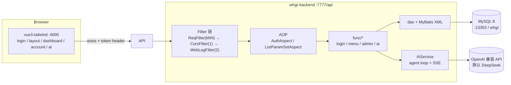

# whgr 项目总览

> Work Hard to Get Rich。极简 B 端脚手架：**登录 → 动态菜单 → 账号增删改查 + AI 主入口**。
> 仓库 https://github.com/tuean/whgr （branch `main`），MIT。
>
> 本文件是清理后的现状快照：仓库里只剩「跑得起来、用得着」的部分。

---

## 1. 结构

| 模块 | 技术 | 说明 |
|---|---|---|
| `whgr-backend` | Spring Boot 2.7.18 / MyBatis / MySQL 8 / `--release 8` | 后端全部业务，59 个 Java 文件 |
| `vue3-tailwind` | Vite 2 + Vue 3 + daisyUI + Element Plus | 唯一前端，5 个页面 + 2 个 api 文件 |
| `agent/` | JDK 21 + Jackson，无 Spring | 独立可跑的 Java coding agent（`read/write/edit/bash` + session），不参与后端构建 |
| `sql/init-table.sql` | MySQL | 建表 + 种子数据，compose 首次启动自动执行 |

根目录没有聚合 `pom.xml`：`whgr-backend` 与 `agent` 各自独立构建，没有需要事先 `mvn install` 的内部依赖。

```
whgr/
├── whgr-backend/
│   ├── src/main/java/com/tuean/whgr/
│   │   ├── func/{login,menu,admin,ai}/   业务模块（Controller + Service）
│   │   ├── dao/ + resources/mapper/main/  MyBatis Mapper
│   │   ├── entity/, enums/, exception/
│   │   ├── aop/{AuthAspect,ListParamSetAspect}
│   │   ├── filter/{ReqFilter,CorsFilter,WebLogFilter}
│   │   └── util/, http/, helper/
│   └── src/main/resources/application.properties
├── vue3-tailwind/src/{api,views,router}
├── agent/
├── sql/init-table.sql
└── docker-compose.yml
```

---

## 2. 架构



### 请求链路

1. **`ReqFilter`**（`@Order(MIN_VALUE)`）：取/生成请求号写 MDC + 响应头 `req`。
2. **`CorsFilter`**（`@Order(1)`）：读 `cors.allow.headers` 放行头。
3. **`WebLogFilter`**（`@Order(2)`）：包装 request/response 打印完整出入参；`/ai/chat` 与 `Accept: text/event-stream` 直接跳过（否则 SSE 会被缓冲）。
4. **AOP**：`AuthAspect` 做登录态（`@NoAccess` 免登录）+ 角色（`@RequireRole(N)` 要求 `role <= N`）；`ListParamSetAspect` 把 `pageNum/pageSize` 换算成 `startRow/endRow`。
5. **Controller**：必须放在 `com.tuean.whgr.func.<业务>.<Controller>`（切点是 `func.*.*.*(..)`，位置错了鉴权静默失效）。
6. **数据源**：Spring Boot 自动配置 + HikariCP，`@MapperScan("com.tuean.whgr.dao")` 在启动类上，`mybatis.mapper-locations=classpath:mapper/main/*.xml`。
7. **异常**：`GlobalExceptionHandler` 统一出口；`NeedLoginException`→419、`NoPermissionException`→403。

---

## 3. 本地怎么跑（实测）

本机只有 JDK 21/25（无 8），MySQL 走 Docker。源码保持 Java 8 语法，`JAVA_HOME` 指 21。

| 组件 | 值 |
|---|---|
| JDK | 21（`/opt/homebrew/opt/openjdk@21`），`pom` 仍 `java.version=1.8` |
| Spring Boot | 2.7.18（2.7.1 的 Spring 5.3.20 在 JDK 21 上不稳） |
| MySQL | 8.0 arm64，容器 `mysql1`，`localhost:13303`，库 `whgr`，root/root |
| 前端 | Vite 2 dev `:4000`；`element-plus` 锁 `2.14.8`（1.x 样式路径不兼容） |

```bash
export JAVA_HOME=/opt/homebrew/opt/openjdk@21

docker compose up -d                                   # 首次启动自动执行 sql/init-table.sql
(cd whgr-backend && mvn spring-boot:run)               # :7777/api，约 6s
(cd vue3-tailwind && npm install && npm run dev)       # :4000
```

数据库里已有种子数据（`sql/init-table.sql`）：

- 账号：`admin / admin`（role=1 管理员）、`normal / normal`（role=2 普通用户）
- 菜单：`/ai`（AI 入口，所有人）、`/dashboard`（工作台，所有人）、`/account`（账号管理，role<=1）

重新初始化数据库：`docker compose down -v && docker compose up -d`。

> `sql/init-table.sql` 首行必须是 `SET NAMES utf8mb4;`。容器里的 mysql 客户端在 C locale 下默认 latin1，不写这行会把中文写成双重编码（`hex(name)` 会看到 `C3A7C2AE…`）。

登录自测：

```bash
curl -X POST http://127.0.0.1:7777/api/adminUser/login \
  -H 'Content-Type: application/json' \
  -d '{"userName":"admin","passwordMd5":"21232f297a57a5a743894a0e4a801fc3"}'
# → {"code":0,"data":{"loginUserName":"admin","nickName":"管理员","token":"..."}}
```

---

## 4. 接口清单

| 接口 | 方法 | 鉴权 | 说明 |
|---|---|---|---|
| `/adminUser/login` | POST | 免登录 | `{userName, passwordMd5}` → `{loginUserName, nickName, token}` |
| `/logout` | DELETE | 免登录 | 前端清 token 即可，服务端不注销 |
| `/adminUser/profile` | GET | 需要 | 当前登录人 |
| `/menu/list` | GET | 需要 | 菜单按当前账号角色过滤 |
| `/admin/list` | POST | `@RequireRole(1)` | `{pageNum,pageSize,searchKey}` → `{total,finished,list}`，不返回 pwd |
| `/admin/save` | POST | `@RequireRole(1)` | 无 id 新增（密码必填，md5 落库），有 id 更新（`pwd` 留空不改） |
| `/admin/delete?id=` | POST | `@RequireRole(1)` | 不能删自己 |
| `/ai/chat` | POST | 需要 | `{message}` → **SSE** 事件流 |
| `/ai/history` | POST | 需要 | 我的问答历史 `{pageNum,pageSize}` |
| `/ai/history/{id}` | GET | 需要 | 单条完整轨迹（自己的；管理员可看全部） |

约定：

- 统一响应 `MineResp{code,message,data}`（成功 0、错误 -1、无权限 403、未登录 419）；列表 `{total,finished,list}`。
- `ListParamSetAspect` 把 `pageNum/pageSize` 换成 `startRow/endRow`，Mapper 里直接 `limit #{startRow}, #{endRow}`（`startRow` 是偏移量，`endRow` 实际是 limit）。
- 新增业务模块要动四处：`func/<模块>/{XxxController,XxxService}.java`、`dao/XxxMapper.java`、`resources/mapper/main/XxxMapper.xml`、前端 `api/index.js` 加一行。
- 新增公开接口必须标 `@NoAccess`，否则 `AuthAspect` 默认要求登录。

---

## 5. AI 入口是主入口

登录后直接落在 `/ai`：左边对话、右边历史回溯。

```
一句话 → 后端 agent 循环（请求模型 → 执行 tool_calls → 结果回填 → 收尾）
       → SSE 边跑边推 → 前端按 type 渲染时间线 → 有 navigate 就出跳转卡 → router.push
```

**SSE 事件**（`POST /ai/chat`）：

| type | 内容 | 前端渲染 |
|---|---|---|
| `thinking` | 模型 `reasoning_content` | 灰色斜体「思考」 |
| `decision` | 调工具前说的话 | 黄色「决策」 |
| `tool` | 工具名 + 参数 + 返回 | 「调用 xxx」+ 可展开 |
| `action` | `{path,label}` | 绿色跳转卡 + 「打开」 |
| `answer` | 最终回复 | 对话气泡 |
| `done` / `error` | 日志 id / 错误 | — |

**回溯**：每轮落 `ai_log`（`message / reply / actions / trace`），右侧列表 `POST /ai/history`，点开 `GET /ai/history/{id}` 铺回时间线并标「历史记录回放」；只能看自己的，管理员能看全部。

**三层权限**

1. 菜单层：`menus.role` —— `0` 所有人，`N` 表示 `role <= N` 可见。`/menu/list` 与 AI 的 `list_menus` 用同一份过滤结果，AI 看不到无权菜单。
2. 动作层：`navigate` 的 path 必须命中菜单白名单，否则回 `ERROR` 让模型重试。
3. 接口层：`@RequireRole` + `AuthAspect`（403），前端路由守卫再用 `sessionStorage.menuPaths` 兜一层，手敲 URL 弹回 `/ai`。

**配置**（`application.properties`）：`ai.enabled / base-url / model / api-key / max-steps / timeout-seconds`，key 默认取 `AI_API_KEY` 或 `DEEPSEEK_API_KEY`；没配 key 时接口返回「AI 未配置」而不是 500。

**工具只有两个纯数据动作**（`list_menus` / `navigate`），没有文件与命令能力 —— 提示注入最多跳错页面。

---

## 6. 坑（改代码前先看）

- **`SseEmitter.send` 发字符串，不发 `ObjectNode`**：项目 JSON 层由 Gson 处理，序列化 Jackson 节点会输出 `_children`/`_nodeFactory`。`/ai/history/{id}` 也返回 POJO + 原样字符串，前端 `JSON.parse`。
- **`AuthAspect` 切点必须列全 6 种 Mapping 注解**：`@annotation(RequestMapping)` 不认 `@GetMapping/@PostMapping` 这类派生注解，漏了就是接口静默裸奔。
- **SSE 请求必须在 `WebLogFilter` 里跳过**：response wrapper 会把事件缓冲到连接结束。
- **`server.tomcat.threads.max=50`**：SSE 长连接独占线程，设成 1 会把整个服务堵死。
- **`ai.vue` 的每轮对话对象要 `reactive`**：普通对象改字段不触发渲染。
- **`mapper-locations` 只扫 `mapper/main/`**：XML 放 `mapper/` 根目录不会加载。
- **`limit #{startRow}, #{endRow}`** 是「偏移, 条数」，`endRow` 不是行号。
- **`db` 参数 / 动态数据源已删除**：现在是单数据源，需要多库时再加 `AbstractRoutingDataSource`。
- `menus` 只按 `role` 过滤，没有按钮级权限；任务队列、WebSocket、ES 等示例代码已全部移除。

## 7. 已知待办

1. `/logout` 只清前端 token，服务端 token 不过期（`admin_token` 表没有过期清理）。
2. AI 单轮对话，不带上文（追问「那这个页面怎么用」接不上）。
3. 历史列表固定前 20 条，没有翻页 UI；SSE 线程池固定 4 线程。
4. `thinking` 原样展示模型内部推理，敏感场景需要过滤。
5. 没有自动化测试（后端 `src/test` 已清空），CI 未配。
6. 数据库密码明文写在 `application.properties`，公网部署前必须换环境变量。

---

*运行步骤、接口、坑均为本机实测结果（`mvn compile` / `vite build` 通过，登录 + 菜单 + 账号 CRUD + AI SSE + 历史回溯 + 角色 403 全部走通）。*
